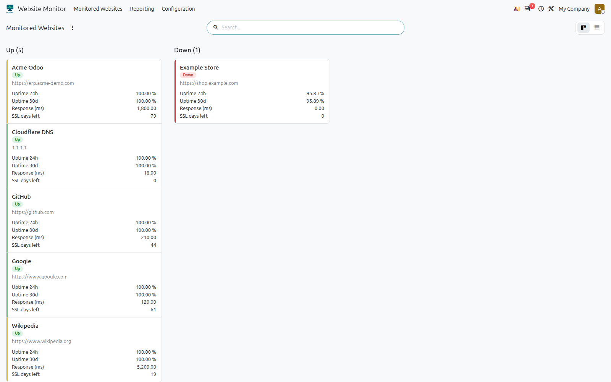
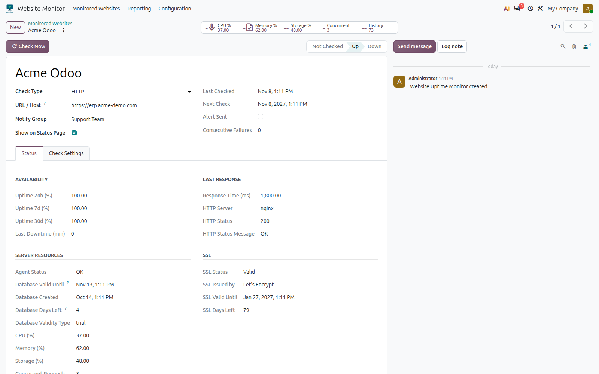
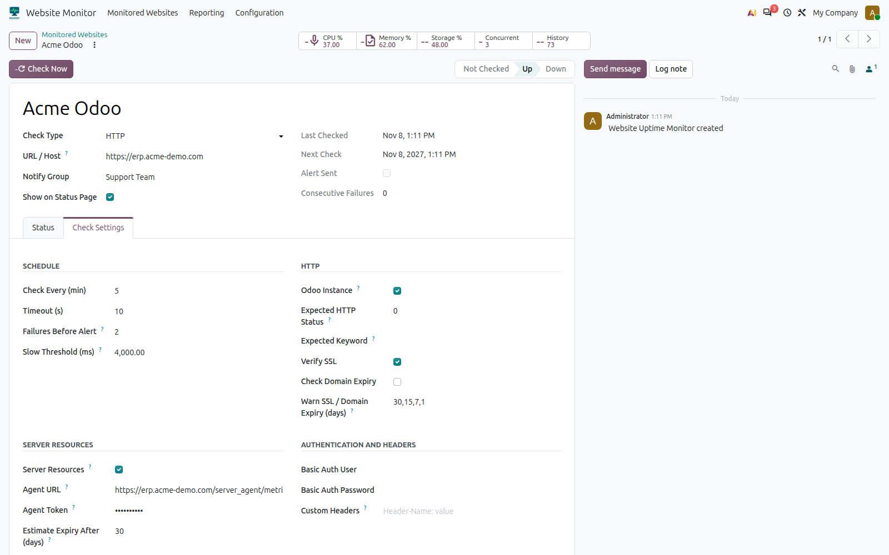
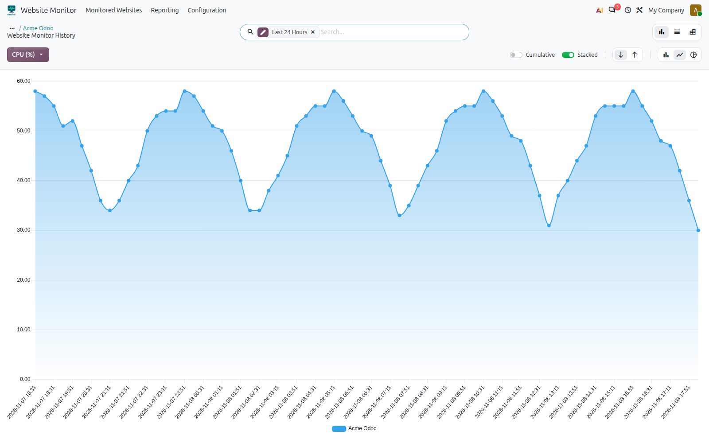
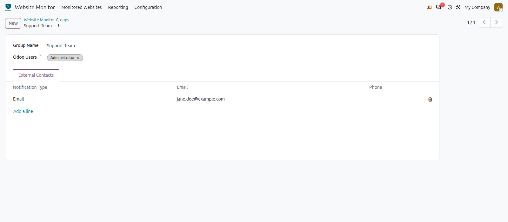
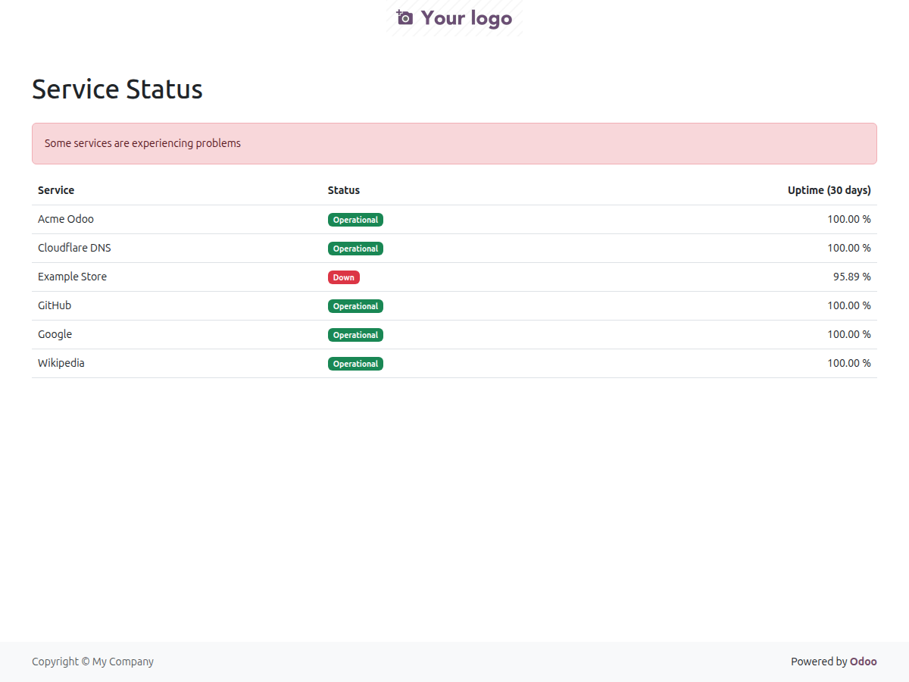

# Server monitoring modules for Odoo

Two addons to watch websites and Odoo servers. There is **one branch per Odoo
version**: `20.0`, `19.0`, `18.0` and `17.0`.

| Module | Where to install it | What it does |
|---|---|---|
| `server_uptime_monitor` | The Odoo that runs the monitoring | Checks websites and TCP services (availability, response time, SSL, domain expiry), measures the slowness of Odoo instances, reads server resources and database validity, sends email alerts and publishes a status page. |
| `server_resource_agent` | Every Odoo server you want to watch | Exposes `/server_agent/metrics`, a read-only, token-protected endpoint: CPU, memory, storage, concurrent requests and database validity. |

```
┌──────────── Monitoring Odoo ─────────────┐         ┌──────── Watched Odoo server ──────────┐
│ server_uptime_monitor                    │  HTTPS  │ server_resource_agent                 │
│  cron every minute → threads → checks ───┼────────►│  GET /server_agent/metrics (token)    │
│  history, alerts, /status page           │         │  CPU · memory · disk · concurrency    │
└──────────────────────────────────────────┘         └───────────────────────────────────────┘
```

## Documentation

- [Functional guide](docs/functional.md): what it does, how to configure and use it, which alerts are sent.
- [Technical documentation](docs/technical.md): architecture, models, agent endpoint, security, tests and porting between versions.
- Per-module READMEs (Odoo format): `server_uptime_monitor/README.rst` and `server_resource_agent/README.rst`.

## Screenshots

**Monitored Websites**: one card per monitor, colored by state (green healthy,
yellow with warnings, red down).



**Monitor form**: last result, availability, SSL, server resources and database
validity, with one smart button per metric.



**Check settings**: schedule, HTTP options, thresholds, server resources and
authentication.



**Resource charts**: CPU, memory, storage and concurrent requests over time.



**Notification group**: Odoo users and external contacts who receive the alerts.



**Public status page** (`/status`): name, state and 30-day uptime only, never the URLs.



## Quick start

1. On the monitoring Odoo, install `server_uptime_monitor` (requires the Python package `requests`).
2. *Website Monitor ▸ Configuration ▸ Groups*: create a group with the users or contacts who will receive the emails.
3. *Website Monitor ▸ Monitored Websites*: create a monitor with a name, URL and group.
4. For your own Odoo server: tick *Odoo Instance*; if you also want resources, install `server_resource_agent` there (requires `psutil`), copy the token from the system parameter `server_resource_agent.token` and enable it in the *Check Settings ▸ Server Resources* tab.
5. Make sure Odoo's outgoing mail server works: without it, alerts stay in the queue.

## Versions

| Branch | Main differences |
|---|---|
| `20.0` | Development base (`ir.access.csv`, `models.Constraint`, `env._`, `get_str/set_str`). |
| `19.0` | `ir.model.access.csv`, `get_param/set_param`. |
| `18.0` | `_sql_constraints`; groups with a category (no `res.groups.privilege`). |
| `17.0` | `_()` imported, `tree` views, `kanban-box`, chatter as a `div`, `numbercall` on the cron, `group_operator`. |

Fixes are made first on `20.0` and ported downwards
(`20.0 → 19.0 → 18.0 → 17.0`).

## Tests

```
odoo -d <db> -i server_uptime_monitor,server_resource_agent \
     --test-tags /server_uptime_monitor,/server_resource_agent --stop-after-init
```

50 tests, all green on `20.0`.

## License and author

Copyright © Angel Guadarrama ([github.com/fr33co](https://github.com/fr33co)).
Licensed under the [GNU Lesser General Public License v3.0](LICENSE) (LGPL-3).
