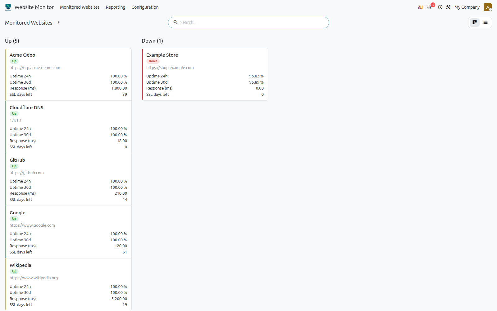
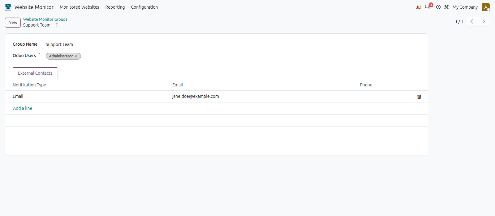
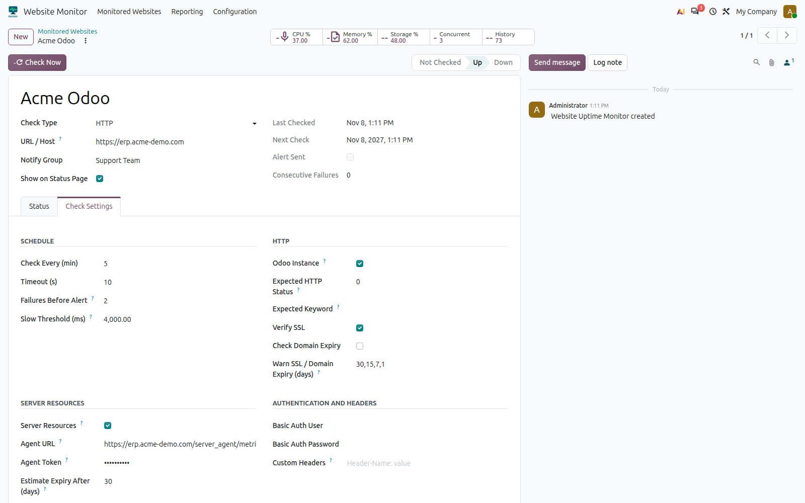
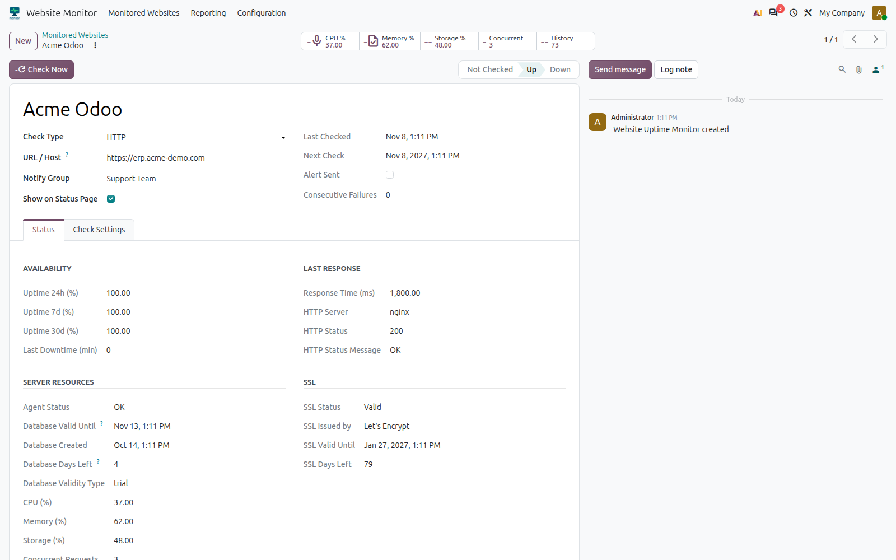
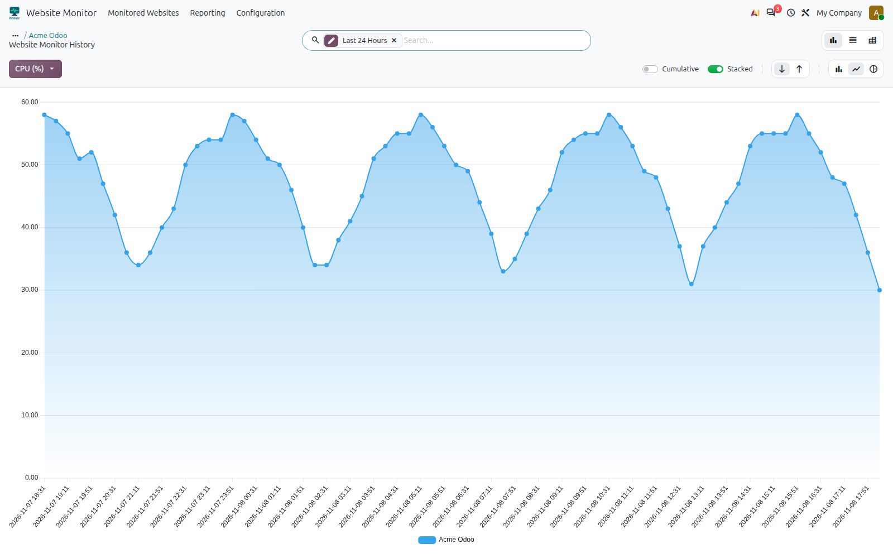
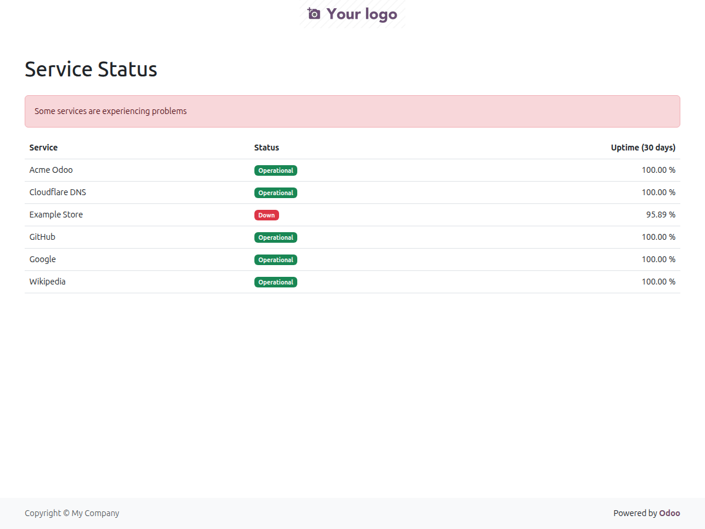

# Functional guide

## 1. What problem it solves

- Know when a site or service **goes down**, **slows down** or is about to **expire** (SSL certificate, domain, Odoo demo/trial database).
- Know when an **Odoo instance** is overloaded (CPU, memory, disk, concurrent requests) without logging in to the server.
- Notify the right people by email, **once per incident**, and notify them again when it recovers.

## 2. Roles

| Group (*Settings ▸ Users ▸ Website Monitor*) | Can |
|---|---|
| **User** | View monitors, groups, contacts and history. |
| **Administrator** | Everything above, plus create/edit/delete, and see the *Configuration* menu, the basic-auth credentials, the custom headers and the agent token. Give it only to trusted people: monitors make requests from the monitoring server. |

## 3. Menus

- **Monitored Websites**: kanban grouped by status (green healthy, yellow with warnings, red down), list and form.
- **Reporting ▸ History**: line chart, list and pivot of the history of every check.
- **Configuration ▸ Groups / Contacts**: who gets notified.

## 4. Configuring who is notified

1. **Groups**: create a group (e.g. "Support"). Add *Odoo users* (the email of their contact card is used) and/or *external contacts* (email only).
2. Each monitor belongs to one group (*Notify Group*).

> Telegram-type contacts can be saved, but no message is sent through that channel yet.

## 5. Creating a monitor

Basic fields: **Name**, **URL / Host**, **Check type** (HTTP or TCP port), **Notify group**, and *Show on Status Page* if it should appear on the public page.

**Check Settings** tab:

| Section | Field | Meaning |
|---|---|---|
| Schedule | Check Every (min) | How often it is checked (default 5). |
| | Timeout (s) | Maximum time to wait. |
| | Failures Before Alert | Consecutive failures before alerting (default 2). Avoids false alarms. |
| | Slow Threshold (ms) | A response slower than this counts as a problem (default 4000). |
| HTTP | Odoo Instance | Measures the way an Odoo instance needs it (see §6). |
| | Method / Expected Status / Expected Keyword | GET/HEAD method, expected status code (0 = anything below 500), text the response must contain. |
| | Verify SSL | Validates the certificate. |
| | Check Domain Expiry | Looks up the domain expiry (RDAP, once a day). |
| | Warn SSL / Domain Expiry (days) | Warning levels, `30,15,7,1` by default. |
| Authentication and Headers | Basic-auth user/password, headers | For protected sites. |
| Server Resources | (see §7) | Only if *Odoo Instance* is ticked. |

**Check Now** button: checks immediately and stores a history row.

## 6. Odoo instances (*Odoo Instance*)

Designed for Odoo.sh or Odoo Online, where you want to know whether the instance is slow without loading it:

- Makes **a single** anonymous request to the site's `/web/login` (the page is rendered by a worker and needs the database, so its latency reflects the real load).
- Measures only the time until the headers arrive and reads at most 64 KiB to confirm that **the response is really Odoo** (a 404 or a foreign site is not reported as healthy).
- Combine it with *Slow Threshold* and *Failures Before Alert* to be alerted only if the slowness persists. Use an interval of 5 minutes or more.

## 7. Server resources and database validity

Only for Odoo servers you **control** (not applicable to Odoo Online / Odoo.sh, where modules that read the host cannot be installed).

1. On the watched server, install `server_resource_agent`. On install it generates a random token in the system parameter `server_resource_agent.token`.
2. On the monitor: tick *Odoo Instance* and *Server Resources*, and paste the token into *Agent Token*. *Agent URL* is optional (defaults to `<site origin>/server_agent/metrics`; mandatory on TCP monitors). An explicit URL must use `https://`, because the token is sent in a header.
3. Adjust the thresholds: *Max CPU/Memory/Storage (%)* (90 by default) and *Max Concurrent Requests* (0 = disabled).

What you get:

- On the form, buttons with **CPU, memory, storage and concurrent requests**; each opens a **chart over time**. If the server is not Odoo, these charts and data are not shown.

- An exceeded threshold counts as a problem and triggers the normal alert flow.
- If the agent does not respond, it is shown in *Agent Status*, but it is **not** treated as the site being down.
- *Concurrent requests* is the **peak** between two checks, so short spikes are not missed.

### Database validity (demos and trials)

Odoo demos and trials expire and usually give no warning. The agent reads the date Odoo stores and the monitor shows it in the *Status* tab:

- If the database reports an `expiration_date`, **that date wins**.
- If it reports none, it is **estimated** as *creation date + Estimate Expiry After (days)* (30 by default) and flagged as *Estimated Expiry* on screen and in the email. Set it to 0 to disable the estimate (databases that do not expire).
- An email is sent **5 days before** by default; configure it in *Warn Database Expiry (days)* (e.g. `30,15,7,5,1`; add `1` for a last warning).
- The kanban card turns yellow when 7 days or fewer remain.

> The date may be out of date until Odoo syncs with its publisher. The "one month" shown in *Settings* is only a provisional value (today + 30 days).

## 8. Emails sent

| Email | When |
|---|---|
| **Alert** | When *Failures Before Alert* consecutive problems are reached (down, unexpected status, keyword missing, SSL error, slowness, resource over threshold). Once per incident. |
| **Recovery** | When the monitor is healthy again; states the minutes of downtime. |
| **Expiry** | SSL, domain or database: once on crossing each configured day level, and when already expired. |

If the server is Odoo, the alert email includes the resources. The emails are translated into Spanish (`es_ES`).

## 9. Statuses and colors

| Color | Meaning |
|---|---|
| Grey | Not checked yet. |
| Green | Up with no problems. |
| Yellow | Up but with a warning: slow, high resource usage, SSL about to expire or database about to expire. |
| Red | Down. |

## 10. History and purge

Every scheduled check stores a row (response time, HTTP status and, where applicable, resources). Rows older than **90 days** are purged automatically; change this with the system parameter `server_uptime_monitor.history_retention_days`.

## 11. Public status page

`/status` lists the monitors with *Show on Status Page*: only name, status and 30-day uptime. **It never exposes URLs.**

## 12. Known limitations

- Telegram does not send messages yet.
- The domain is recognized with a simple second-level suffix rule (`.com.co`, `.co.uk`, `.gob.mx`…), not the full public suffix list. Platform domains (`odoo.com`, `odoo.sh`, `odoo.dev`) are skipped on purpose.
- The chart axis (`check_label`) is in UTC.
- Delivery depends on the database's outgoing mail server.

## 13. Troubleshooting

| Symptom | Cause / solution |
|---|---|
| Alerts do not arrive | No outgoing mail server, or the group has no contacts with an email. Check *Settings ▸ Technical ▸ Emails*. |
| *Agent Status* = `HTTP 404 (check URL and token)` | Wrong token, IP outside `allowed_ips`, module not installed or wrong URL (the agent answers 404 on purpose). |
| *Agent Status* = `Error: …` | No connection to the server, invalid certificate (check *Verify SSL*) or non-JSON response. |
| Domain expiry stays empty | Platform domain, an IP, or the registry does not publish a date (`domain_status` explains it). |
| After upgrading the module, error "is not a valid action" | Restart the Odoo service **before** upgrading so the new code is loaded. |
